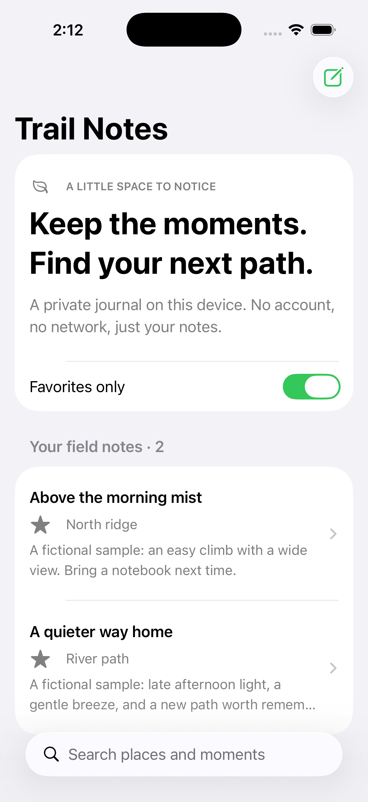

# Trail Notes

[](https://github.com/RamySaleeb/trail-notes-ios/actions/workflows/ci.yml)

An original native iOS field journal built with Swift and SwiftUI. Capture small moments, find them by title, place, or notes, and keep favorites close.

**Status:** working iOS simulator demo. Built with Xcode 26.6 and manually checked on iPhone 17 Pro / iOS 26.5. Fifteen Swift Testing tests cover core behavior, recovery, and parameterized search edge cases. Source is public on GitHub. Not distributed through TestFlight or the App Store.



## Native by design

- SwiftUI navigation, search, sheets, forms, and system controls.
- Semantic colors and scalable system typography.
- On-device JSON persistence with atomic writes and serialized actor access.
- Explicit loading and save failures; corrupt journals are not silently replaced.
- No account, network requests, analytics, third-party libraries, or private source.

The included entries are fictional examples. Data is stored in the app's Application Support directory. This prototype does not implement encryption beyond platform protections, cloud sync, export, editing, or deletion. Removing the app can remove its data.

## Code map

| Path | Responsibility |
| --- | --- |
| `TrailNotes/Core/Journal.swift` | Codable value model, query rules, actor-backed disk repository |
| `TrailNotes/Core/JournalModel.swift` | Injectable observable model and compose draft state |
| `TrailNotes/TrailNotesApp.swift` | SwiftUI app, navigation, composition |
| `Tests/TrailNotesCoreTests/JournalTests.swift` | Filtering, ordering, round trips, missing/empty/corrupt data |

The core is a standalone Swift package. The presentation layer depends on the core; storage does not depend on SwiftUI. State changes are committed only after a successful save. A failed new-note save keeps the draft available.

## Run the tests

Requires Swift 6 or later on macOS:

```sh
swift test
```

Search regression fixtures use fixed IDs and timestamps. They cover empty and whitespace-only queries (including Unicode whitespace), independent title/place/notes matches, favorites with nonmatching queries, and unchanged input order and values. Unicode cases check composed/decomposed `é` in both directions and an exact Japanese substring. Search retains `localizedStandardContains`; these tests avoid locale-specific case mappings and do not claim identical accent folding or collation in every locale.

## Run the iOS app

1. Open `TrailNotes.xcodeproj` in Xcode 26.6 or later.
2. Select the **TrailNotes** scheme and an iOS 26.5 or later simulator.
3. Press Run. No credentials, backend, or package downloads are needed.

The checked-in project retains the template's iOS 26.5 deployment target. The same core files are compiled by both the app's synchronized source folder and the standalone test package, so no duplicate implementation or package-linking step is needed.

```sh
xcodebuild -project TrailNotes.xcodeproj -scheme TrailNotes \
  -sdk iphonesimulator -configuration Debug \
  -derivedDataPath /tmp/TrailNotesBuild CODE_SIGNING_ALLOWED=NO build
```

To run on a physical device, choose your own signing team in Xcode. This native demo is not a browser application.

## Walkthrough

1. Launch to see two clearly fictional field notes.
2. Search `ridge` or a word within a note; combine search with Favorites only.
3. Open a note and toggle its favorite state.
4. Create a note using the compose button. A nonblank title is required.
5. Relaunch to confirm saved notes persist.

Verified on iPhone 17 Pro / iOS 26.5: launch, note details, favorite label updates, favorite filtering, search, new-note save, and persistence after terminating and relaunching the app. The screenshot shows fictional sample entries after favoriting both.

Still to validate: VoiceOver reading order, full keyboard navigation, accessibility text sizes, iPad layouts, and physical-device behavior. The automated tests cover core behavior, model recovery, and compose draft retention; there is not yet an automated UI test target.

## Storage recovery

`JournalModel(storage:)` accepts any `JournalStorage`; the default remains the real actor-backed JSON repository. The file format is unchanged. A missing file seeds fictional examples; a saved empty array stays empty, and a failed load does not seed or overwrite data.

Failed saves retain existing entries. In the compose sheet, the draft remains available and Save retries it; the sheet dismisses only after success. Fields and dismissal are disabled during a save. The sheet owns its error alert, avoiding a second alert underneath it. Successful retries clear error state. Overlapping load/save operations are rejected instead of queueing stale snapshots.

Run `swift test` to exercise injected load/save failures and retry, busy-state cleanup, empty-versus-missing journals, competing saves, blank-title rejection, and draft retention. The fake storage uses continuations for concurrency tests—no sleeps, network, or disk-permission tricks. Draft retention is tested at the presentation-state level; automated simulator UI testing remains future work.

## Contributing and roadmap

Start with the [contribution guide](CONTRIBUTING.md) for setup, local checks, code boundaries, and the pull request checklist. GitHub Actions runs core tests and an unsigned iOS simulator build on pushes and pull requests. UI and accessibility validation remain separate checks.

| Issue | Scope |
| --- | --- |
| [#1 Search edge-case tests](https://github.com/RamySaleeb/trail-notes-ios/issues/1) | Implemented: blank/Unicode whitespace, field matches, combined filters, canonical Unicode equivalence, and input immutability |
| [#2 Accessibility validation](https://github.com/RamySaleeb/trail-notes-ios/issues/2) | VoiceOver, Dynamic Type, keyboard navigation, and documented device checks |
| [#3 Injectable storage and failure recovery](https://github.com/RamySaleeb/trail-notes-ios/issues/3) | Implemented: deterministic model tests for failed load/save and retry |
| [#4 Safe editing and deletion](https://github.com/RamySaleeb/trail-notes-ios/issues/4) | Preserve identity and drafts, confirm deletion, and verify persistence |

Each issue includes acceptance criteria and exclusions. Comment before starting to coordinate work. These are proposed contributions, not promised delivery dates. Use original code and fictional journal data only.
