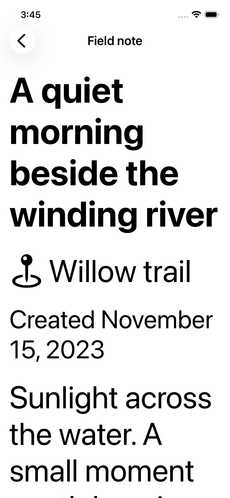
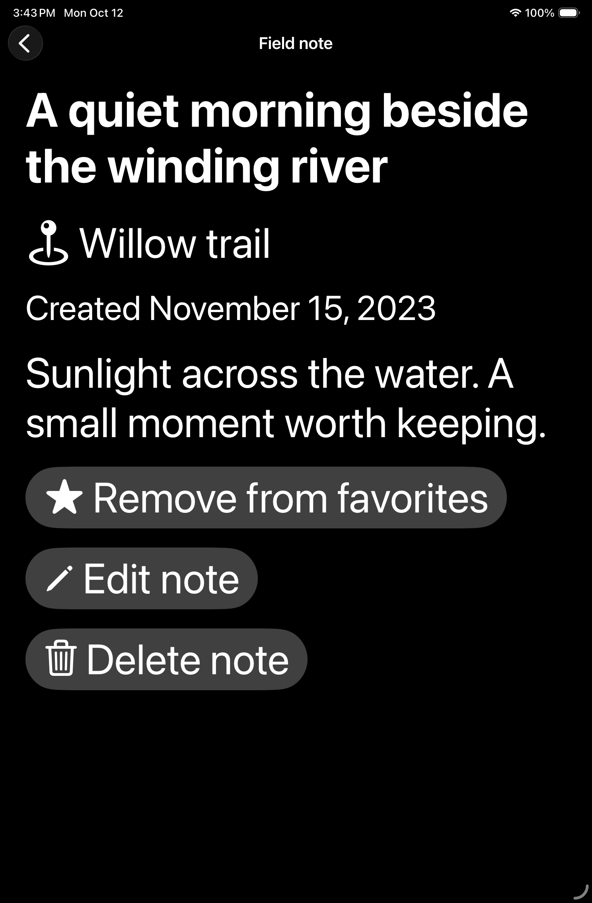
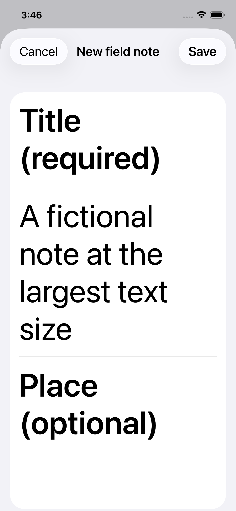
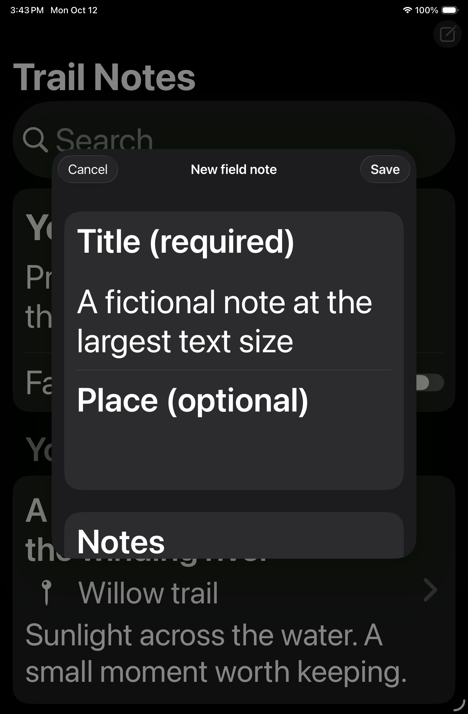

# Accessibility validation

Trail Notes uses native SwiftUI controls, semantic text sizes, and system colors. This record describes the checks performed; it is not accessibility certification or a claim of full WCAG conformance.

## Changes

- Note rows expose one descriptive title/place label, an explicit Favorite or Not a favorite value, and an opens-note hint. A visible Favorite label also avoids relying on the star icon alone.
- Detail titles are headings. Favorite, edit, and delete controls have wrapping labels and a minimum 44-point height.
- Accessibility text sizes expand note previews and simplify the introductory heading. Lists, forms, and details scroll; essential content is not constrained to fixed text heights.
- Compose and edit fields retain visible labels and explicit accessibility labels, including required/optional status. Previous/Next/Done controls provide an alternative to reaching a lower field with the software keyboard open.
- Command-N opens a note and Command-S saves. Native Cancel discards the draft. Tab and Shift-Tab move between compose fields; navigation at field boundaries is left to the system.
- Accessibility focus is requested on the title when a sheet opens, on its triggering New note/Edit note button when it closes, on Notes after a save error, and on the retry/action control after journal/deletion errors. On-device VoiceOver confirmation is still required.

## Reproduce automated checks

```sh
swift test --parallel
xcodebuild -project TrailNotes.xcodeproj -scheme TrailNotes \
  -destination 'platform=iOS Simulator,name=iPhone 17e,OS=latest' \
  -parallel-testing-enabled NO -resultBundlePath /tmp/TrailNotesAccessibility.xcresult \
  CODE_SIGNING_ALLOWED=NO test
```

Repeat with `name=iPad mini (A17 Pro)`. Xcode 26.6 and iOS/iPadOS 26.5 are the development baseline. Open the result bundle in Xcode for screenshots, accessibility audit diagnostics, and individual test results. CI retains these result bundles for 14 days.

The UI tests inject fixed fictional in-memory data and one-shot storage failures through DEBUG-only launch settings. They never read or overwrite the on-device journal. Tests use element expectations rather than sleeps. The existing core tests remain separate.

## Recorded results — 12 October 2026

Xcode 26.6 / Swift 6.3.3. All 24 core tests passed. The same app/test build passed all five UI tests on each destination below, with no excluded audit failures.

| Simulator | OS | Result |
|---|---|---|
| iPhone 17e (390 × 844 points) | iOS 26.5 | 5 UI tests passed |
| iPad mini (A17 Pro), portrait | iPadOS 26.5 | 5 UI tests passed |

The largest-text test uses accessibility XXXL in light and dark appearances. Audits check text clipping, sufficient descriptions, hit regions, and contrast on the list, detail, and compose surfaces. Other tests verify row/favorite semantics, search/empty results, Command-N/Command-S, Tab/Shift-Tab between fields, save-failure draft retention/retry, load retry, edit cancellation, and deletion confirmation cancellation. Native Cancel is tested by activation; no close/edit keyboard shortcut is promised. Full Keyboard Access remains a separate manual check.

Screenshots below come from these passing tests and contain only fictional fixture data. Offscreen content is scrollable; the keyboard Previous/Next controls also reach the note editor.

| iPhone: largest text, light | iPad: largest text, dark |
|---|---|
|  |  |
|  |  |

## VoiceOver check still required on a physical device

Apple's [accessibility testing guidance](https://developer.apple.com/documentation/accessibility/performing-accessibility-testing-for-your-app) calls for testing with VoiceOver on a physical device. Simulator hierarchy inspection and audits do not verify spoken output or actual assistive-technology focus.

With a fictional journal and VoiceOver enabled:

1. Traverse the list: navigation title/actions, search, journal introduction, Favorites only, section heading/count, then note rows. Each row should announce title, place, favorite state, and its action without repeating its children.
2. Open a note: title heading, place, date, body, favorite, edit, delete. Toggle favorite and confirm the new state is announced.
3. Open/cancel/save a new or edited note. Confirm initial focus reaches Title and dismissal returns to New note or Edit note as appropriate.
4. Exercise failed load/save/delete in a development test fixture. Confirm alerts are announced, dismissing them restores focus to the relevant retry control or Notes, and the draft/entry remains intact.
5. Search for no matching notes, toggle favorites, and inspect loading/empty states. Confirm status and recovery actions are understandable.

Record physical device, OS, observed reading order, focus behavior, and any remaining defects in issue #2 before marking that criterion complete. Full Keyboard Access, Switch Control, Voice Control, other languages, and physical-device behavior remain separate manual validation work.
